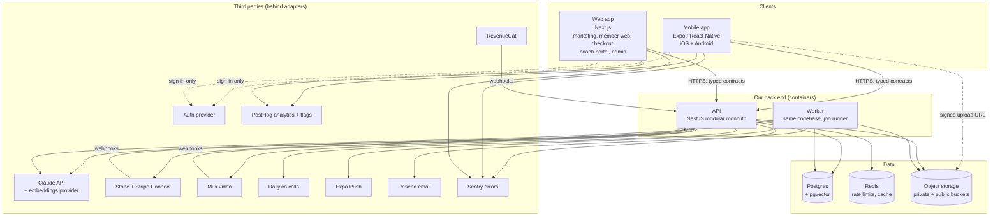

# 01. Architecture

This is the target architecture for the **full** app. Phase 1 builds a subset of the features, but on this exact architecture, so nothing has to be thrown away later.

## 1. Guiding principles

1. **Build the skeleton for the full app; switch features on over time.** Foundations (identity, roles, entitlements, credits, events, contracts) are designed for Phase 3 from day one. Features arrive behind flags.
2. **One language end to end.** TypeScript in mobile, web, API, workers and shared packages.
3. **One API in front of everything.** Clients never touch the database or third-party back ends directly.
4. **Modular monolith first.** One deployable API with strict internal module boundaries. Split out a service only when data shows it is needed.
5. **Contracts first.** Every endpoint is a typed contract shared by server and clients.
6. **Buy commodity, build differentiation.** Video, calls, payments, push and analytics are bought. The coaching experience, the AI coach, personalisation and the community are built.
7. **Everything replaceable.** Each vendor sits behind an adapter. Postgres is standard Postgres. Containers run anywhere.
8. **Boring where possible.** Prefer mature, well-documented tools that humans and AI agents both know well.

## 2. System overview

## 3. Clients

### 3.1 Mobile (`apps/mobile`)
- **Expo** (managed workflow with dev builds and config plugins), latest stable SDK at the start of Phase 0, upgraded each SDK release within 8 weeks.
- **Expo Router** for navigation (file-based, deep-link ready).
- **TanStack Query** for all server state (caching, retries, offline persistence). **Zustand** only for small local UI state. No other state libraries.
- **ts-rest client** generated from `packages/contracts`.
- **NativeWind** (Tailwind for React Native) with tokens from `packages/ui-tokens`. A small in-house component library in `apps/mobile/src/components/ui/`.
- **expo-video** and Mux playback for video; **react-native-track-player** for audio with background playback.
- **RevenueCat SDK** for in-app purchases.
- **Daily React Native SDK** for calls.
- **Sentry**, **PostHog** SDKs.
- **EAS Build** and **EAS Submit** for store builds; **EAS Update** for over-the-air JS updates (see 02-engineering-standards, release rules).
- Secure token storage in Keychain or Keystore via `expo-secure-store`.

### 3.2 Web (`apps/web`)
- **Next.js** (App Router), deployed on Vercel.
- Route groups, each with its own layout and access rules:
  - `(marketing)`: public site, SEO, pricing, legal pages, partner venue pages.
  - `(checkout)`: web purchase flow (Stripe Checkout and customer portal).
  - `(member)`: member web app (lessons, AI chat, bookings). Phase 2 onward; Phase 1 can be checkout plus account management only.
  - `(coach)`: coach portal.
  - `(admin)`: admin console and moderation queue.
- **Tailwind CSS** and **shadcn/ui**, tokens from `packages/ui-tokens`.
- Talks to the API through the same ts-rest contracts. Server components may call the API server-to-server with the user's token. The web app has no database access of its own.

## 4. Approved stack

Adding a production dependency not in this table needs human approval (see CLAUDE.md section 6) and, if significant, an ADR.

| Concern | Choice | Notes |
|---|---|---|
| Language | TypeScript (strict) | Everywhere |
| Package manager and monorepo | pnpm workspaces + Turborepo | |
| Mobile | Expo, Expo Router, React Native | ADR 0002 |
| Web | Next.js App Router | |
| API framework | NestJS (Fastify adapter) | ADR 0003 |
| API contracts | ts-rest + Zod in `packages/contracts`, OpenAPI generated | ADR 0004 |
| Database | PostgreSQL 16+ with pgvector | ADR 0005. Hosted on Supabase at start; portable |
| ORM and migrations | Drizzle ORM + drizzle-kit | |
| Auth | Supabase Auth (Apple, Google, email magic link and password, later passkeys). API verifies JWTs | ADR 0006. Behind `AuthAdapter` |
| Object storage | Supabase Storage (S3 compatible) behind `StorageAdapter` | Private bucket for user uploads |
| Background jobs | pg-boss (Postgres-backed queue) | ADR 0007. No extra infrastructure, transactional enqueue |
| Cache and rate limiting | Redis (Upstash or host-provided) | Never a source of truth |
| Domain events | In-process event bus + transactional outbox table, dispatched via pg-boss | ADR 0007 |
| AI models | Anthropic Claude API | ADR 0008. Model IDs live in config, never in code |
| Embeddings | Voyage AI behind `EmbeddingsAdapter` | Swappable |
| In-app purchases | RevenueCat | ADR 0009 |
| Web payments | Stripe (Checkout, Billing, Customer Portal) | |
| Coach payouts | Stripe Connect Express | |
| Video hosting | Mux | |
| Calls | Daily.co | Behind `CallsAdapter`; LiveKit is the fallback |
| Push | Expo Push Service | Behind `PushAdapter` |
| Email | Resend + React Email templates | |
| Analytics, feature flags, experiments | PostHog | Behind thin wrappers in each app |
| Errors and performance | Sentry | |
| Logs | pino (structured JSON) to the host's log drain, then Better Stack or Axiom | |
| Validation | Zod | Shared across all layers |
| Dates | `date-fns` + `date-fns-tz` | All time zone maths in `packages/shared` |
| Testing | Vitest, Testcontainers, Playwright, Maestro, k6 | See standards |
| API hosting | Render (Docker) at start | Same container moves to AWS ECS or Fly.io if needed |
| Web hosting | Vercel | |
| Secrets | Host environment variables, validated by Zod at boot | `.env.example` lists every variable |

## 5. The API (`apps/api`)

### 5.1 Shape
- One NestJS application with two entry points built from the same code:
  - `main.ts`: HTTP server.
  - `worker.ts`: job runner (pg-boss consumers, scheduled jobs, outbox dispatcher).
- Both run as separate containers so heavy jobs never slow down requests.

### 5.2 Modules
Full list and responsibilities: `specs/modules.md`. Summary:

| Module | Owns |
|---|---|
| `identity` | Users, profiles, roles, sessions, devices, consents, account deletion |
| `onboarding` | Goals, assessments, onboarding state, roadmap generation |
| `content` | Lessons, courses, collections, media assets, progress, scripts library |
| `coaching` | Roadmaps, journals, habits, exercises, weekly reports |
| `ai` | Coach Mia AI conversations, analyses, knowledge base, prompts, safety, AI usage |
| `billing` | Products, prices, entitlements, purchases, credits ledger, referrals, promos, payouts |
| `bookings` | Coaches, availability, sessions, calls, session notes, reviews |
| `community` | Groups, posts, comments, reactions, reports, moderation actions, pseudonyms |
| `gamification` | Challenges, streaks, badges, points, levels, leaderboards |
| `events` | Member events, retreats, tickets, partner venues |
| `notifications` | Push tokens, preferences, templates, scheduled messages, inbox |
| `admin` | Audit log, admin-only orchestration (reads through other modules' public interfaces) |

### 5.3 Module rules (enforced by lint and review)
1. A module's tables are only read and written by that module's repository.
2. Other modules import only from `modules/<name>/index.ts`.
3. Synchronous cross-module calls are allowed for queries and for commands that must succeed together. Everything else uses domain events.
4. No circular dependencies between modules. `dependency-cruiser` fails CI on cycles.
5. `platform/` and `adapters/` may be imported by any module. They never import from a module.
6. Every module has its own Postgres schema (for example `billing.entitlement_grants`). This makes ownership visible and makes later extraction possible.

### 5.4 Request lifecycle
1. Fastify receives the request; request ID assigned; structured log context created.
2. Rate limiter (Redis) by user and by IP.
3. Auth guard verifies the JWT (issuer, audience, expiry, signature via JWKS) and loads the user's roles.
4. Permission guard checks the permission declared on the route (see `specs/identity-and-roles.md`).
5. ts-rest validates the request body, query and params against the Zod contract.
6. Controller calls the service. Service enforces business rules and resource ownership.
7. Repository accesses the database inside a transaction when needed. Events written to the outbox in the same transaction.
8. Response validated against the contract in non-production environments.
9. Errors mapped to the standard error shape (see standards section 6).

### 5.5 Domain events and the outbox
- When something important happens (lesson completed, purchase confirmed, booking created), the service writes a row to `platform.outbox` **in the same transaction** as the state change.
- The worker's outbox dispatcher reads new rows and enqueues a pg-boss job per subscriber.
- Subscribers are idempotent: each event has an ID, and each subscriber records which event IDs it has processed.
- Event names: `<module>.<entity>.<past-tense-verb>`, for example `content.lesson.completed`, `billing.entitlement.granted`. Payloads are versioned Zod schemas in `packages/contracts/events/`.
- This keeps modules decoupled: gamification reacts to `content.lesson.completed` without content knowing gamification exists.

### 5.6 Background jobs
Typical jobs: AI screenshot analysis, embedding new content, weekly reports, streak checks at the user's local midnight, reminder notifications, webhook processing, payout runs, data deletion, media processing callbacks. Every job is idempotent, has a retry policy with backoff, and lands in a dead-letter queue after the final retry, which raises an alert.

## 6. Data layer
- **Postgres is the single source of truth.** Details in `03-data-model.md`.
- Hosted on Supabase at the start (Postgres + Auth + Storage), with point-in-time recovery switched on before any real user data exists.
- Row Level Security is switched on for every table with **no policies that grant client access**. Clients never use the database API. This is defence in depth in case a key leaks.
- The API connects with a dedicated database role, through a connection pooler.
- **pgvector** stores embeddings for the AI knowledge base. Move to a dedicated vector store only if measured performance requires it.
- **Redis** is cache and rate limiting only. Losing Redis must never lose data.
- **Object storage** buckets:
  - `public-media`: thumbnails, avatars, marketing assets (CDN cached).
  - `private-uploads`: screenshots, journal attachments. Signed URLs only, short expiry, lifecycle deletion rules.
  - Video and audio lesson media live in Mux, not in our buckets.

## 7. Identity, roles and entitlements (summary)
Specs: `specs/identity-and-roles.md`, `specs/billing-and-entitlements.md`.

- One account per person. Roles attach to the account (member, coach, senior_coach, moderator, admin, partner). A member can later also become a coach without a new account.
- Permissions are named constants in `packages/shared/permissions.ts`, mapped to roles in one place.
- What a user can access because they paid is answered only by `billing.hasEntitlement(userId, key)`. Entitlements are granted from RevenueCat, Stripe, admin grants, referrals and promos, all into one table.
- AI usage is paid with credits from an append-only ledger.

## 8. AI layer (summary)
Spec: `specs/ai-coach.md`.

- All AI work goes through the `ai` module, which wraps the Claude API in a provider gateway.
- Coach Mia's knowledge comes from retrieval over Mia's own content (RAG) plus a carefully written system prompt that sets her voice and principles. No custom model training.
- Every AI call is priced in credits, reserved before the call and settled after it from the token usage the API reports.
- Safety layer: input checks, output checks, crisis routing, refusal handling, ethics rules, and an evaluation suite that must pass before prompt or model changes ship.

## 9. Payments (summary)
Spec: `specs/billing-and-entitlements.md`.

- RevenueCat handles App Store and Google Play subscriptions, and also receives Stripe web purchases, so it holds one cross-platform view of subscriptions.
- Our `billing` module is the source of truth for entitlements in our app, fed by RevenueCat and Stripe webhooks.
- Stripe handles web subscriptions, one-off purchases, sessions, events and retreats. Stripe Connect pays coaches.
- Which purchase routes are shown in the app (link out to web or not) is a server-side configuration per country and per store, because store rules differ by region and change over time.

## 10. Calls and live sessions
- 1:1 and group calls use Daily.co rooms created by the `bookings` module just in time, with short-lived meeting tokens tied to the booking.
- Recording is off by default. If ever enabled, it needs explicit consent from everyone and its own retention rule.
- Webinars (Phase 3) use the same adapter with a broadcast layout.

## 11. Notifications
- One `notifications` module decides what to send, when, and through which channel (push, email, in-app inbox), respecting user preferences and quiet hours in the user's time zone.
- Other modules never call the push or email vendor. They publish events; notifications subscribes.

## 12. Observability
- **Logs:** structured JSON with request ID, user ID (never content), module, event. Log levels used consistently.
- **Errors:** Sentry on mobile, web, API and worker with release tracking and source maps.
- **Metrics and alerts:** uptime checks on API and web, job queue depth, dead-letter count, webhook failure rate, AI spend per hour, p95 latency per route, database CPU and connections.
- **Product analytics:** PostHog with a tracking plan in `packages/shared/analytics/events.ts`. Event names are typed constants.
- **AI observability:** every AI call records model, tokens in and out, cache hits, latency, credits charged, safety flags (no content in logs; content kept only where `specs/ai-coach.md` says).

## 13. Environments

| Environment | Purpose | Data | Deploys |
|---|---|---|---|
| `local` | Development | Seed data, local Docker Postgres | Developer machine |
| `preview` | Per pull request (web and API where practical) | Seed data | Automatic on PR |
| `staging` | Release candidate, store test builds | Synthetic data only, never real user data | Automatic on merge to `main` |
| `production` | Live | Real data | Manual promotion of a staging build, with approval |

Each environment has its own database, storage buckets, auth project, vendor accounts or sandboxes (Stripe test mode, RevenueCat sandbox, Mux test environment) and API keys.

## 14. Security model (summary)
- TLS everywhere. HSTS on web.
- JWT verification on every request. Short-lived access tokens, refresh handled by the auth SDK.
- Permission check on every route, ownership check in every service method that loads a user-owned resource.
- Input validation by contract on every route.
- Rate limits on auth, AI, uploads and write endpoints.
- Uploads: content type and size validated, images re-encoded server-side to strip metadata, scanned before AI processing.
- Secrets only in environment variables. Rotation procedure documented in `infra/RUNBOOK.md` (Phase 0).
- Admin actions written to an append-only audit log.
- Dependency scanning, secret scanning and static analysis in CI.
- Privacy by design: data minimisation, retention schedules, deletion and export (F-106).

## 15. Scaling path (when, not now)

| Signal | Action |
|---|---|
| API CPU high under normal load | Scale API containers horizontally (stateless by design) |
| Slow queries | Indexes, query fixes, read replica for reporting |
| AI jobs crowding other jobs | Separate worker pool for the `ai` queue |
| AI module needs independent deploys or scaling | Extract `ai` to its own service; its schema and public interface already isolate it |
| Community realtime load | Add a realtime layer (Supabase Realtime, Ably or similar) behind an adapter |
| Vector search slow at large scale | Dedicated vector store behind `EmbeddingsAdapter` and a `KnowledgeIndex` interface |
| Hosting limits | Move containers to AWS ECS with Terraform; Postgres to RDS or Aurora via logical replication |
