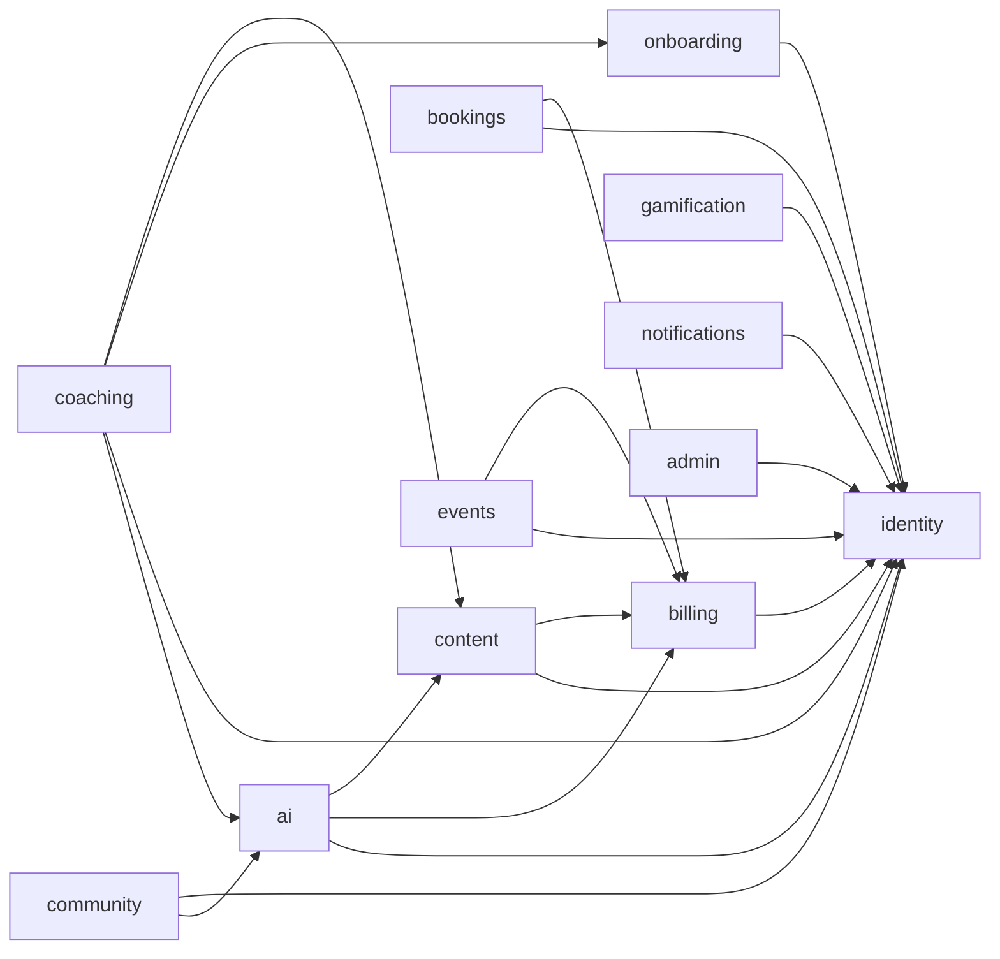

# Spec: Backend Modules

Each module lives in `apps/api/src/modules/<name>/`, owns the Postgres schema of the same name, and exposes a public interface in `index.ts`. This file is the contract between modules. Update it in the same PR whenever a module's interface or events change.

Format per module: purpose, owns, public interface (callable by other modules), publishes, consumes, phase.

---

## identity
- **Purpose:** who someone is and what roles they hold.
- **Owns:** users, role_assignments, profiles, community_identities, devices, consents, deletion_requests.
- **Public interface:** `getUser(id)`, `getUsers(ids)`, `getRoles(userId)`, `hasPermission(userId, permission)`, `getTimeZone(userId)`, `getLocale(userId)`, `getCommunityIdentity(userId)`.
- **Publishes:** `identity.user.created`, `identity.user.updated`, `identity.role.granted`, `identity.role.revoked`, `identity.consent.changed`, `identity.deletion.requested`, `identity.deletion.executing`.
- **Consumes:** none.
- **Phase:** 0.

## onboarding
- **Purpose:** first-run experience, goals, assessments.
- **Owns:** assessments, assessment_questions, assessment_responses, user_goals, onboarding_state.
- **Public interface:** `getGoals(userId)`, `getLatestAssessmentResult(userId, kind)`.
- **Publishes:** `onboarding.goals.set`, `onboarding.assessment.completed`, `onboarding.completed`.
- **Consumes:** `identity.user.created` (initialise state).
- **Phase:** 1.

## content
- **Purpose:** the lesson library and progress through it.
- **Owns:** lessons, media_assets, courses, course_lessons, collections, collection_items, tags, lesson_tags, lesson_progress, content_translations.
- **Public interface:** `getLesson(id)`, `getLessons(ids)`, `getPublishedLessonsForIngestion(since)`, `getProgress(userId, lessonIds)`, `searchLessons(query, filters)`.
- **Publishes:** `content.lesson.published`, `content.lesson.updated`, `content.lesson.archived`, `content.lesson.started`, `content.lesson.completed`, `content.course.completed`.
- **Consumes:** Mux webhooks (via adapter), `identity.deletion.executing`.
- **Phase:** 1.

## coaching
- **Purpose:** the personal path and self-work tools.
- **Owns:** roadmaps, roadmap_steps, journal_entries, habits, habit_checkins, weekly_reports.
- **Public interface:** `getRoadmap(userId)`, `getNextSteps(userId, n)`.
- **Publishes:** `coaching.roadmap.generated`, `coaching.step.completed`, `coaching.journal.entry_created`, `coaching.habit.checked_in`.
- **Consumes:** `onboarding.assessment.completed`, `onboarding.goals.set` (generate roadmap), `content.lesson.completed`, `gamification.challenge.completed`, `bookings.session.completed` (advance steps), `identity.deletion.executing`.
- **Phase:** 1 (roadmap), 2 (journal, habits, weekly reports).

## ai
- **Purpose:** everything Coach Mia AI does. Spec: `ai-coach.md`.
- **Owns:** conversations, messages, analyses, user_memory, knowledge_documents, knowledge_chunks, prompt_versions, ai_calls, safety_events.
- **Public interface:** `generateWeeklyInsight(userId, metrics)` (used by coaching), `classifyText(text, purpose)` (used by community moderation), `rankRoadmapSteps(userId, candidates)` (optional, Phase 2).
- **Publishes:** `ai.message.completed`, `ai.analysis.completed`, `ai.safety.flagged`.
- **Consumes:** `content.lesson.published`, `content.lesson.updated`, `content.lesson.archived` (re-ingest knowledge), `identity.deletion.executing`.
- **Phase:** 1.

## billing
- **Purpose:** money, access and credits. Spec: `billing-and-entitlements.md`.
- **Owns:** products, prices, entitlement_definitions, product_entitlements, entitlement_grants, purchases, subscriptions, credit_ledger, credit_wallets, referral_codes, referrals, promo_codes, promo_redemptions, coach_payout_accounts, payout_items, webhook_events.
- **Public interface:** `hasEntitlement(userId, key)`, `listEntitlements(userId)`, `getCreditBalance(userId)`, `reserveCredits(userId, amount, ref)`, `settleCredits(reservationId, actual)`, `releaseCredits(reservationId)`, `createCheckout(userId, productKey, context)`, `chargeForBooking(userId, bookingId, productKey)`, `recordCoachEarning(bookingId)`.
- **Publishes:** `billing.purchase.completed`, `billing.purchase.refunded`, `billing.subscription.started`, `billing.subscription.renewed`, `billing.subscription.cancelled`, `billing.subscription.expired`, `billing.entitlement.granted`, `billing.entitlement.revoked`, `billing.credits.low`, `billing.referral.rewarded`, `billing.payout.paid`.
- **Consumes:** RevenueCat and Stripe webhooks, `bookings.session.completed` (earnings), `bookings.booking.cancelled` (refund rules), `identity.deletion.executing` (pseudonymise financial records).
- **Phase:** 0 (core), 1, 2 (referrals, promos, payouts).

## bookings
- **Purpose:** live coaching sessions with Mia and other coaches.
- **Owns:** coaches, session_types, availability_rules, availability_exceptions, bookings, booking_attendees, session_notes, reviews.
- **Public interface:** `getUpcomingSessions(userId)`, `getCoach(id)`, `isCoach(userId)`.
- **Publishes:** `bookings.booking.held`, `bookings.booking.confirmed`, `bookings.booking.cancelled`, `bookings.booking.rescheduled`, `bookings.session.completed`, `bookings.session.no_show`, `bookings.review.submitted`.
- **Consumes:** `billing.purchase.completed` (confirm held booking), `identity.role.granted` (create coach profile), `identity.deletion.executing`.
- **Phase:** 1 (Mia), 2 (guest coaches, groups).

## community
- **Purpose:** groups, posts and moderation.
- **Owns:** groups, group_members, posts, comments, reactions, reports, moderation_actions, sanctions.
- **Public interface:** `getUserSanctions(userId)`.
- **Publishes:** `community.post.created`, `community.post.approved`, `community.post.removed`, `community.comment.created`, `community.report.created`, `community.sanction.applied`, `community.win.shared`.
- **Consumes:** `identity.deletion.executing`, `identity.user.updated`.
- **Phase:** 2.

## gamification
- **Purpose:** motivation through challenges, points, streaks, badges and levels.
- **Owns:** challenges, challenge_assignments, point_ledger, streaks, badges, user_badges, levels.
- **Public interface:** `getSummary(userId)` (points, level, streaks, recent badges).
- **Publishes:** `gamification.points.awarded`, `gamification.streak.extended`, `gamification.streak.at_risk`, `gamification.streak.broken`, `gamification.badge.awarded`, `gamification.level.reached`, `gamification.challenge.completed`.
- **Consumes:** `content.lesson.completed`, `content.course.completed`, `onboarding.completed`, `coaching.journal.entry_created`, `coaching.habit.checked_in`, `bookings.session.completed`, `community.win.shared`, `identity.deletion.executing`.
- **Phase:** 1 (core), 2 (full), 3 (leaderboards).

## events
- **Purpose:** member events, retreats and partner venues.
- **Owns:** venues, member_events, event_tickets, venue_recommendations.
- **Public interface:** `getUpcomingEventsForUser(userId)`.
- **Publishes:** `events.ticket.issued`, `events.ticket.cancelled`, `events.event.reminder_due`.
- **Consumes:** `billing.purchase.completed` (issue tickets), `billing.purchase.refunded`, `identity.deletion.executing`.
- **Phase:** 3.

## notifications
- **Purpose:** decide what to tell whom, when and how.
- **Owns:** preferences, scheduled_notifications, inbox_items, delivery_log.
- **Public interface:** none needed by others (they publish events instead). Admin may call `sendBroadcast(segment, template)`.
- **Publishes:** `notifications.delivered`, `notifications.failed`.
- **Consumes:** most user-relevant events from other modules, for example `bookings.booking.confirmed`, `gamification.streak.at_risk`, `billing.subscription.expired`, `billing.credits.low`, `community.comment.created`, `identity.user.created`.
- **Phase:** 1.

## admin
- **Purpose:** admin-only orchestration and the audit trail.
- **Owns:** audit_log.
- **Public interface:** `recordAudit(actorId, action, target, before, after)` (every module calls this for admin actions).
- **Publishes:** none.
- **Consumes:** none.
- **Phase:** 0 (audit), 1 (console).

---

## Dependency direction (allowed synchronous calls)

Any synchronous call not shown here needs this diagram updated and a reviewer's approval. If a new arrow would create a cycle, use an event instead.
